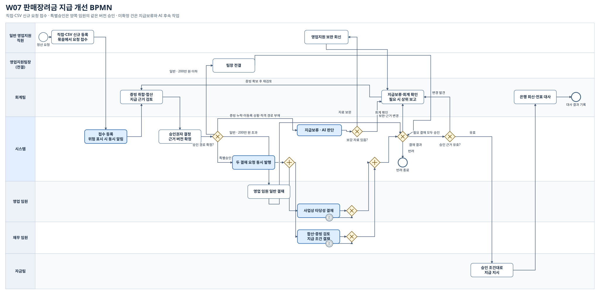
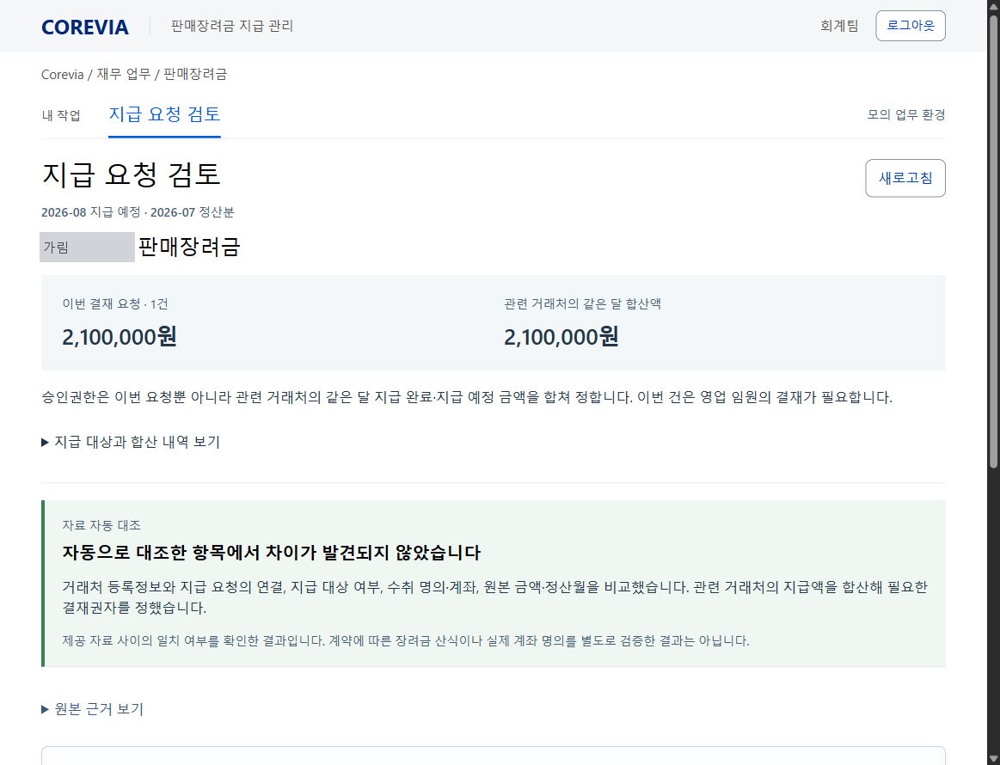
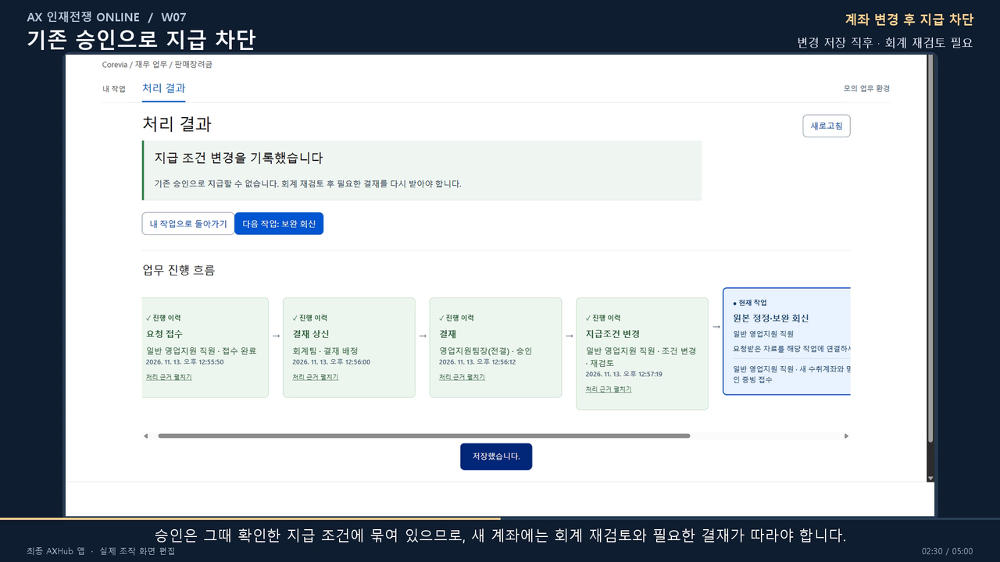
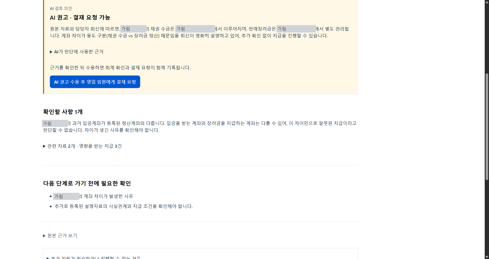
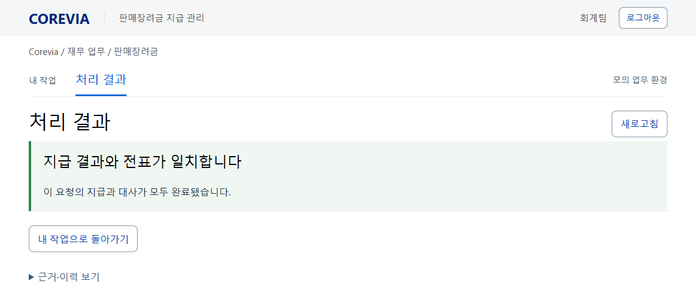

# W07 · 관련 거래처의 판매장려금 지급 검토

회계 담당자가 판매장려금을 **지급하기 전에** 누구의 결재가 필요한지, 승인한 조건 그대로 지급하는지 판단하도록 돕는 웹 앱입니다.
한 건씩 나눠 결재 한도를 피하는 지급, 승인 뒤 바뀐 수취계좌, 같은 건의 중복 지급을 지급 전에 막고, 지급 뒤에는 은행 회신과 전표를 대사합니다.
제가 정한 것은 지급 전에 잡아야 할 예외, 역할별 권한과 결재 경로, AI에 넘길 근거와 범위, 검증 시나리오입니다. 규칙은 코드 · 판단 보조는 AI · 승인은 사람이 맡습니다.

근거: [통제 설계](#통제-설계) · [구현 중 되돌린 결정](#구현-중-되돌린-결정) · [검증 기록](작업/검증기록/) · [설계결정기록](작업/W07_설계결정기록.md) · [테스트 62개](app/test/)

AX 인재전쟁 ONLINE 삼일PwC 회차에 개인 과제로 제출한 앱입니다(2026-11-13 제출). 가상 기업 Aurora 그룹의 제조 자회사 Corevia가 대리점에 판매장려금을 지급하는 상황을 다뤘습니다. 지급·대사 결과는 대회 시나리오에서 모의한 값입니다. 실제 고객사 도입이나 송금, 운영 성과를 입증하는 사례로 제시하지 않습니다.

[제출 앱 열기](https://app-q1zb.axhub.app) · [개인 회고 읽기(노션)](https://jelly-snapper-928.notion.site/41750951fc84810cbae9ef9f5bc3c0ee) — 제출 앱은 심사 종료 후 접속이 중단될 수 있습니다.

## 어떤 문제를 풀었나

한 건씩 보면 팀장 전결 범위(200만 원 이하)에 드는 장려금도, 서로 관련된 거래처가 같은 달에 받는 금액을 합하면 임원 결재가 필요할 수 있습니다. 회계 담당자가 지급 전에 “어떤 거래처를 함께 봤는지, 얼마를 합산했는지, 그때 어떤 근거로 승인했는지” 확인할 수 있도록 검토 단위를 바꿨습니다.

## 한 건이 지급되기까지

1. **영업 접수** — 영업지원이 거래처, 금액, 지급예정월을 등록합니다.
2. **규칙 검토** — 서버가 마스터의 관계 단서로 거래처를 묶고, 월 합산액과 결재 기준을 대조합니다. 정상 건은 이 결과로 회계 확인에 넘깁니다.
3. **예외 판단과 보완** — 증빙이 모자라거나 해석이 필요한 건은 NVIDIA NIM에 관련 근거를 보냅니다. AI가 추가로 확인할 자료를 제안하면 영업이 회신하고, 갱신된 근거로 다시 검토합니다.
4. **회계 확인과 결재** — 회계 담당자가 규칙 결과와 AI 의견을 확인해 상신합니다. 건의 조건에 따라 팀장 전결, 임원 결재 또는 영업·재무 임원의 특별승인을 거칩니다.
5. **모의 지급과 대사** — 자금 담당자가 승인 조건을 확인한 뒤 모의 지급을 실행합니다. 회계 담당자는 지급 회신과 전표를 대조해 차이를 확인합니다.



## 화면

제출 앱의 실제 화면입니다. 대회 제공 자료의 거래처명과 계좌 끝자리는 회색 상자로 가렸습니다.

**1. 정상 건은 규칙으로 자동 대조합니다.** 거래처 등록정보·지급 대상 여부·수취 명의와 계좌·금액·정산월을 비교하고, 관련 거래처의 같은 달 합산액(2,100,000원)으로 영업 임원 결재가 필요하다고 판단했습니다. 이 건에서는 AI를 호출하지 않았습니다.



**2. 승인 뒤 수취계좌를 바꾸면 기존 승인으로는 지급할 수 없습니다.** 지급조건 변경을 저장하는 즉시 기존 결재가 효력을 잃고, 회계 재검토와 새 결재가 다음 단계로 열립니다.



**3. AI는 담당자 회신을 읽고 다시 판단합니다.** 거래처의 과거 입금계좌가 등록된 정산계좌와 달라 AI가 사유를 물었고, 영업이 두 계좌의 용도를 설명한 모의 회신을 등록하자 새 자료 버전으로 다시 판단했습니다. 회계 담당자가 근거를 확인한 뒤 수용해야 결재 요청으로 넘어갑니다.



**4. 지급 결과와 전표를 대사해 건을 닫습니다.**



5분 시연 영상은 [노션 회고](https://jelly-snapper-928.notion.site/41750951fc84810cbae9ef9f5bc3c0ee)에 있습니다.

## 통제 설계

지급 전에 막아야 할 위험과, 그 위험을 다루는 통제를 짝지었습니다.

| 위험 | 통제 | 종류 | 구현 위치 |
|---|---|---|---|
| 관련 거래처로 나눠 지급해 결재 한도를 피함 | 마스터의 관계 단서로 거래처를 묶고, 월 합산액으로 결재 경로를 정함 | 승인 한도 | [`groups`](app/domain.mjs#L48) · [`ledger`](app/domain.mjs#L82) · [결재 경로](app/domain.mjs#L101) |
| 한 사람이 접수부터 지급까지 처리 | 영업지원·회계·임원·자금 담당의 역할별 권한 | 직무 분리 | [역할 정의](app/domain.mjs#L16) · [권한 검사](app/domain.mjs#L36) · [자기 승인 차단](app/domain.mjs#L131) |
| 승인 뒤 계좌 등 지급 조건이 바뀜 | 결재한 버전과 지급 직전 조건을 대조하고, 다르면 지급을 막고 재검토 | 변경 통제 | [승인 근거 대조](app/domain.mjs#L126) · [지급 직전 재검사](app/domain.mjs#L490) |
| 같은 건을 두 번 지급 | 중복 지급 방지 검사 | 예방 통제 | [기존 지시 확인](app/domain.mjs#L492) · [DB 고유 키](app/store.mjs#L14) |
| 지급 결과가 승인 내용과 다름 | 지급 회신과 전표 대사 | 적발 통제 | [은행 회신 대조](app/domain.mjs#L499) · [전표 대사](app/domain.mjs#L516) |
| AI 판단의 근거를 나중에 확인할 수 없음 | AI 의견에 원본 인용과 자료 버전을 남기고, 근거가 빠지면 다시 판단하게 함 | 감사 추적 | [응답 검증](app/ai.mjs#L66) · [인용 원문 대조](app/ai.mjs#L91) · [재판단 요청](app/ai.mjs#L143) |

## 구현 중 되돌린 결정

| 날짜 | 처음 형태 | 바꾼 형태 | 이유 |
|---|---|---|---|
| 11-12 | 지급 건마다 별도 증빙 파일을 필수로 받음 (AI가 요청을 해석해 추가) | 대회 원본 세 표(대리점 마스터·장려금 지급표·채권 회수 이력)를 가공해 검토 근거로 사용 | 원본 자료에 없는 증빙을 요구하면 업무가 진행되지 않음 |
| 11-12 | 과거 지급 이력으로 지급일을 계산해 추천 (제가 요청) | 추천을 빼고 지급예정월 선택 후 일괄 접수 | 검토 요청 접수에 필요 없는 복잡도였음 |
| 11-13 | 근거가 부족하다며 앱이 AI 권고를 막음 | 자료가 충분한지는 AI가 판단하고, 앱은 인용·자료 버전·권한·지급 조건만 검사 | 앱이 답을 정해 두면 예외 판단을 AI에 맡긴 설계와 어긋남 |
| 11-13 | MVP를 접수·AI 검토·회계 판단으로 줄이자는 제안 (AI) | 결재·모의 지급·대사까지 한 사이클 유지 | 지급 전 통제는 지급과 대사까지 이어져야 확인할 수 있음 |

근거는 [설계결정기록](작업/W07_설계결정기록.md)의 22.22절(별도 확인서 폐기), 22.20·22.24절(지급일 추천 도입과 제거), 22.26·22.27절(AI 보완 판단과 앱 검사 범위), 22.25절(한 사이클 유지)과 [TASK-042](작업/검증기록/TASK042_검증.md)·[TASK-044](작업/검증기록/TASK044_검증.md) 검증 기록에 있습니다.

## 규칙과 AI가 맡은 일

월 합산, 금액 기준, 필수 결재자, 승인 뒤 조건 변경, 중복 지급 방지는 코드로 검사합니다. AI는 예외의 근거를 읽고 부족한 증빙이나 확인할 질문을 제안합니다. 회계 담당자가 의견을 확인하며 결재·지급 권한은 업무 역할에 둡니다. 화면 사용법을 설명하는 AI 안내는 예외에 대한 업무 판단과 별도로 동작합니다.

## 내 역할과 도구

저는 지급 전에 발견해야 할 예외를 정하고, 업무 흐름과 역할별 권한, AI에 전달할 근거와 검증 시나리오를 설계했습니다. 개인 과제를 진행하며 Codex로 구현·테스트 코드와 문서 초안을 작성하고, 시연에서 나온 결과를 확인해 검토 절차와 화면을 수정했습니다. NVIDIA NIM은 앱 실행 중 예외 의견과 화면 안내를 생성하는 데 사용했습니다.

### 설계 문서

- [W07 설계결정기록](작업/W07_설계결정기록.md)에는 예외 처리, 역할별 권한, AI 판단 범위를 선택하고 수정한 과정이 담겨 있습니다.
- [구현지시서](작업/구현지시서.md)에는 결재·지급 조건과 검증 시나리오가 있습니다.
- [AI 작업 지침](AGENTS.md)에는 과제를 진행할 때 Codex에 준 작업 원칙이 있습니다.

## 검증 방법

`app/test/`에는 관련 거래처 합산, 결재 전 지급 차단, 증빙 보완 후 재검토, 역할별 접근과 중복 처리를 확인하는 Node.js 테스트 62개가 있습니다. Node.js 24 이상에서 다음 명령으로 실행합니다. 테스트는 실제 AI 대신 정해 둔 대체 응답을 쓰므로 API 키가 필요 없습니다.

```sh
cd app
npm ci
npm test
```

깨끗한 체크아웃에서 테스트 파일별로 실행하면 62개가 모두 통과했습니다(Node.js 24.19, Windows, 2026-11-20). 한 번에 실행하면 로컬 HTTP 서버를 여는 검사 일부가 이 실행 환경의 포트 제한(`listen EFAULT`)으로 실패할 수 있고, 해당 파일만 다시 실행하면 통과합니다. 원본 데이터로 실행해도 같았습니다.

제출 전 실제 앱에서 확인한 기록은 [작업/검증기록](작업/검증기록/)에 옮겼습니다.

- [구현·검증 추적](작업/검증기록/구현_검증_추적.md): 요구사항별 구현 위치와 검증, 관찰한 실패와 수정
- [TASK-041](작업/검증기록/TASK041_검증.md): 정상 건 한 사이클과 예외 건의 실제 AI 판단. AI가 계좌를 잘못 읽고 진행을 권고했을 때 수용하지 않고 서버 조건을 보강한 과정이 있습니다.
- [TASK-042](작업/검증기록/TASK042_검증.md)·[TASK-044](작업/검증기록/TASK044_검증.md): AI 권고 수용과 보완 회신 후 재판단
- [공개 체험](작업/검증기록/공개체험_검증.md): 로그인 없는 개인별 체험 공간의 격리와 권한

## 재현 범위와 한계

대회 제공 표의 행을 보존한 `app/data/source.json`은 공개하지 않습니다. 대신 [합성 시드](app/data/synthetic-source.json)를 [생성 스크립트](app/scripts/make-synthetic-seed.mjs)와 함께 두었습니다. 합성 시드는 원본과 행 수(대리점 50·지급 240·회수 32), ID 체계, 관련 거래처 묶음 구조만 같고 거래처명·대표자·주소·계좌·금액·날짜는 새로 만든 값입니다. 테스트 코드에 이미 적힌 두 금액(RB-00054 1,373,515원, 관련 거래처 세 건 합계 3,888,097원)만 같게 맞췄습니다. `app/store.mjs`는 `source.json`이 없으면 이 합성 시드를 읽습니다.

이 저장소로 재현할 수 있는 것은 테스트 62개입니다. 다음은 재현되지 않습니다.

- 앱 서버 실행: 역할별 비밀번호 해시(`W07_ACCOUNT_HASHES`)를 직접 만들어 넣어야 합니다.
- 실제 AI 호출: `app/scripts/`의 NIM 점검 스크립트는 NVIDIA API 키가 필요합니다.
- 제출 시연의 화면과 숫자: 위 화면은 대회 원본 자료로 실행한 제출 앱이고, 합성 시드의 거래처명·금액과 다릅니다.

`app/README.md`와 일부 스크립트에는 공개본에서 제외한 원본 CSV, 로컬 비밀 파일, 대회용 원격 검증 스크립트에 대한 참조가 남아 있습니다. 업무 규칙은 [도메인 코드](app/domain.mjs), AI에 맡긴 범위는 [예외 판단 코드](app/ai.mjs), 개선 흐름은 [BPMN 원본](작업/W07_개선.bpmn)에서 확인할 수 있습니다.

설계 문서의 일부 경로는 공개본에서 뺀 대회 자료·실행 기록을 가리키며 (비공개 보관)으로 표시했습니다.

## English summary

A web app that helps an accountant review sales-rebate payments **before money goes out**. It groups related dealers (those sharing at least two of representative, address and bank account) and sums their monthly rebates to pick the required approver, blocks payment if the bank account changes after approval, prevents duplicate payment instructions, and reconciles bank replies and journal vouchers afterwards. Fixed rules live in code; an LLM (NVIDIA NIM) only reviews exceptions and must cite the source rows, and its advice takes effect only after an accountant accepts it and the authorised approvers sign off. Built as an individual entry for the AX Talent War Online (Samil PwC round, Nov 2026) on a fictional company; payments are simulated. The original contest data is not published; a clearly marked synthetic seed lets all 62 tests run from a clean checkout (`cd app && npm ci && npm test`).
