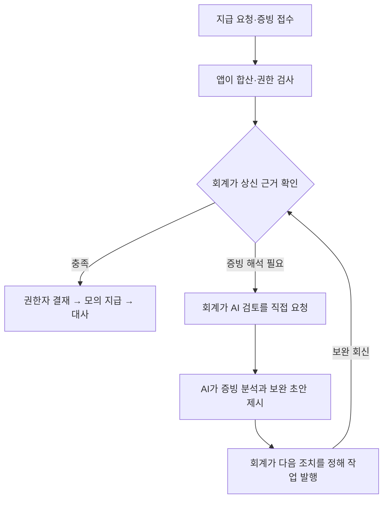
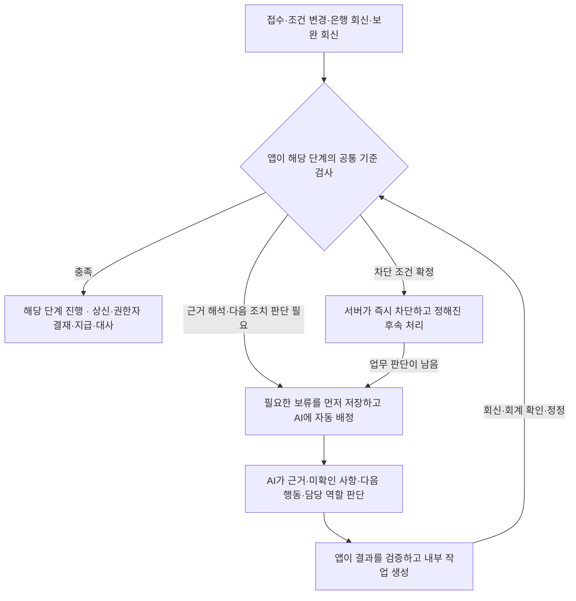

# W07 지급 검토 앱 구현지시서

버전 1.2 · 2026-11-11 · MVP 상세 설계

문서 상태 **구현지시서 확정** · 준비도 **구현 착수 가능** · AXHub 실행과 제출본 수용은 9~11절 검증으로 판정

업무 규칙의 출처는 [원본 승인권한 정책](../01_참가자_배포용/04_원본데이터/00_common/approval_authority_policy.md), [W07 문제 정리 22절](W07_문제정리.md), [확정 개선 BPMN](W07_개선.bpmn)이다. 원본 정책으로 한도와 권한을 판단하고, 22.12절과 개선 BPMN으로 앱의 업무 순서를 정한다. 이 문서는 구현 범위, 판단 조건, 저장할 결과와 수용 기준을 정의한다. 표의 **가정**과 **권장**은 MVP 설계 선택이며 원본에서 확인된 사실과 구분한다.

## 1. 만들 결과와 범위

**확정.** Corevia 판매장려금의 지급 검토 건을 관리하는 앱을 만든다. 영업지원이 자료를 접수하면 회계가 관련자 월 합산과 지급 근거를 확인하고 상신한다. 권한자의 결재 후 자금팀이 모의 지급을 지시하고, 회계가 모의 은행 회신·전표를 건별로 대사한다. 누락된 증빙이나 지급 전 변경으로 보류된 건은 확인 담당자와 재개 조건이 남아야 한다.

MVP는 세 가지 기능으로 구성한다.

1. **접수와 승인 근거 만들기.** 지급 요청과 첨부를 접수하고, 관련자 연결 경로·월 합산액·필요 승인권한을 계산한다.
2. **결재에서 지급·대사까지 처리하기.** 일반·예외 결재에 따라 지급을 열고, 승인 내역과 모의 은행 회신·전표를 대사한다.
3. **변경·증빙 부족 처리하기.** 앱이 공통 기준으로 결론을 내리기 어려운 건을 AI에 넘긴다. AI는 근거·미확인 사항·다음 조치·담당 역할을 판단한다. 앱은 검증된 판단에 따라 내부 작업을 만들고, 회신이 오면 같은 기준으로 재검사한다.

**범위 제외.** 실제 송금과 은행 조사·정정·회수, 은행·회계 시스템 연동, 원장 잔액 대사, 종료된 지급 ID의 재접수·재송금, 장려금 계약과 산식의 독립 재계산, 과거 승인 위반·부정 확정, 전사 BI, 분산 워크플로, 별도 그래프 DB, 자율 Multi-Agent. 계좌 관계는 계산과 검토 근거에 사용한다. 접수부터 대사까지 공통 건 목록·상세 화면을 재사용한다.

## 2. 대표 업무 흐름

**AS-IS · v1.1의 앱 설계**

**TO-BE · v1.2의 앱 설계**

AS-IS는 커밋 `d4fbf65`의 구현지시서 흐름이다. 두 도해는 같은 앱의 AI 처리 방식 비교이며, 부서와 결재의 기준은 [확정 개선 BPMN](W07_개선.bpmn)을 따른다.

**FLOW-01 정상.** 영업지원이 지급 요청 ID, 지급예정일, 첨부를 접수한다. 앱은 관련자 그룹·합산 근거를 계산하고, 회계는 이를 증빙과 대조해 승인할 건 목록을 확정한다. 예외가 없는 경우 월 합산액에 따른 영업권한자가 결재한다. 자금팀은 지급 직전에 해당 버전의 승인과 현재 근거를 확인해 지급 건별 모의 지급 지시를 기록한다. 회계가 은행 회신·전표를 비교하고, 대사 결과가 각 지급 건과 검토 이력에 남는다.

**FLOW-02 예외와 보완.** 접수 또는 검토 중 예외 조건이 성립하면 앱이 즉시 영업·재무 양쪽 승인함에 열람용으로 공개한다. 회계 상신 전에는 양쪽 모두 결재할 수 없다. 회계 상신 시 같은 검토 버전의 두 결재 요청이 함께 등록된다. 둘 다 승인해야 자금팀이 지급을 진행한다. 보완 요청 시 회계 확인 작업이 열린다. 보완 회신은 새 증빙으로 접수하며, 회계가 확인해 새 버전으로 상신한다. 반려는 현재 요청을 종료하고 지급을 차단한다.

**FLOW-03 지급 전 변경.** 승인 후 수취계좌가 변경되면 해당 요청의 미집행 지급을 멈추고 회계 재검토 작업을 만든다. 기존 승인과 증빙은 당시 버전의 이력으로 보존한다. 영업지원이 보완 자료를 접수하고 회계가 변경된 조건을 확인한 뒤, 같은 새 버전으로 필요한 결재를 다시 받는다. 모의 지급과 대사는 FLOW-01의 후반부를 재사용한다.

**FLOW-04 공통 AI 예외 처리.** 접수·지급 조건 변경·모의 은행 회신·보완 회신·회계 확인을 저장한 뒤 4절의 기준을 다시 검사한다. 사실이 충분하면 해당 단계를 진행한다. 이미 확정된 위반·보류·추가 결재 조건은 서버가 즉시 적용한다. 자료가 서로 다르거나 근거가 불충분해 다음 처리를 확정할 수 없으면 7절의 AI 작업을 자동으로 생성한다. 회신 또는 회계 확인 후 미해결 사유와 승인 근거를 다시 검사한다. 이 흐름은 미리 등록한 사례 이름과 무관하게 동작한다.

## 3. 원본, 입력과 저장 기준

**확정된 원본과 관찰값.** 세 CSV를 파이프(`|`)로 구분해 읽는다. 원본 파일은 보존하고 업무에서 쓰는 파생 데이터와 모의 자료는 분리한다.

| 원본 | 연결과 사용 범위 |
| --- | --- |
| [대리점 마스터](../01_참가자_배포용/04_원본데이터/01_corevia/master/m_agency_cv.csv) 50행 | `agency_id`로 연결. 대표자·주소·정산계좌가 관련자 그룹의 입력이다. |
| [판매장려금 지급자료](../01_참가자_배포용/04_원본데이터/01_corevia/sales/sales_rebate_payment_cv.csv) 240행 | `rebate_id`로 지급 요청을 식별한다. `rebate_amount_krw`는 원 단위 지급액, `period_ym`은 정산월이다. `payment_date`가 있는 원본 승인 행은 기록된 지급일 기준의 집계 입력으로 쓴다. 당시 실제 은행 결과나 적정한 승인 근거를 확인했다고 표시하지 않는다. |
| [회수 이력](../01_참가자_배포용/04_원본데이터/01_corevia/financials/fin_collection_history_cv.csv) 32행 | `agency_id`로 연결하고 등록계좌와 비교한다. 입금의 정황과 소명 확인에 쓰며, 지급 수취계좌와 은행 지급 결과는 별도의 입력을 받는다. |

**가정.** 미집행 요청의 지급예정일, 수취계좌와 명의 증빙, 예외 소명, 이해상충 신고, 모의 은행 회신과 전표는 시연용 자료를 사용한다. 원본 지급 요청 ID·정산월·금액은 원본으로 표시한다. 예를 들어 2026년 6월 정산분 RB-00054·RB-00120·RB-00180의 7월 지급 예정은 시연 조건이다. 각 입력에는 원본 또는 모의 여부, 파일·행 ID 또는 증빙 ID, 적용 시점을 남긴다. 시연은 현재 마스터에서 시작하며, 변경 사례는 기존 값과 새 값의 적용 시점을 함께 보존한다. 과거 마스터가 필요하면 추가 자료로 취급한다. (OPEN-01·03·04·07)

**권장 논리 데이터.** 아래 관계를 저장소에서 유지한다.

| 기록 | 식별과 저장할 내용 |
| --- | --- |
| 대리점·지급 요청·회수 이력 | 원본 식별자와 출처. 시연 중 정정은 별도 이벤트로 기록한다. |
| 검토 건·증빙·후속 작업 | 건 ID, 접수자, 대상 지급 요청, 지급예정일, 첨부 참조, 신고·예외 사유, 담당 역할, 요청 자료, 응답과 상태. |
| 검토 버전·결재 | 건 ID와 버전, 그룹 구성원과 연결 근거, 적용 월, 합산에 사용한 행과 금액, 이번 승인 대상과 수취계좌, 예외 사유, 필요한 결재 역할과 담당자. 결재에는 버전·역할·사용자·결정·사유·시각을 남긴다. 상신한 버전은 보존하고 정정은 새 버전으로 상신한다. |
| 지급 지시·회신·전표·대사 결과 | 지급 지시 ID, 지급 요청 ID와 승인 버전, 지시한 금액·계좌, 별도로 접수한 은행 회신 ID·처리일·결과·금액·수취계좌와 모의 전표 ID·금액, 대조 결과와 회계 확인 작업. |
| 처리 이력과 AI 작업 | 건 ID·검토 버전·입력 변경 번호·이벤트 ID·실행자·시각·판정 근거. AI 작업의 호출·판단·적용 또는 실패 결과를 증빙·보류 사유·후속 작업 ID에 연결한다. 보류 사유마다 대상, 담당자, 확인 근거와 해제 여부를 관리한다. |

가져오기 때 필수 헤더, 유일한 ID, 거래처 참조, 날짜와 원 단위 정수 금액을 검사한다. 중복 또는 충돌은 파일·행 ID와 사유를 알려 정정하게 한다. A05에 따라 원본 `NONE`은 해당 없음 코드로 보존한다. 미지급의 `payment_date=NONE`은 지급일이 아직 없음을 뜻한다. 필요한 지급예정일이나 수취계좌 증빙의 누락은 확인 필요로 표시한다. 관계 판정에서는 빈 값과 `NONE`을 일치 항목으로 세지 않는다. 원본과 시연 이력은 권한이 있는 접점에서 조회하며, 시연 초기화는 전용 데이터에만 적용한다. 계좌 표시를 마스킹하고 첨부 본문을 포함한 모델 입력과 실행 로그에 전체 계좌번호·자격 증명을 넣지 않는다.

## 4. 합산과 예외 판정

| 규칙 | 상태와 적용 조건 |
| --- | --- |
| DR-01 관련자 판정 | **확정.** 대표자·주소·정산계좌 중 값이 있는 두 항목 이상이 일치한 거래처를 연결하고, 전이 연결을 포함해 그룹을 만든다. **가정.** MVP는 양끝 공백을 정리한 후 정확히 비교한다. 이름·주소의 유사도 추정은 적용하지 않는다. 직접 일치한 항목과 간접 연결 경로를 남긴다. |
| DR-02 월 합산·권한 | **확정.** 관련자 월 합산액 200만원 이하는 영업지원팀 전결, 초과는 영업 임원 승인이다. **가정(OPEN-01·02).** 완료 건은 기록된 실제 지급월, 미집행 건은 명시된 지급예정월에 포함한다. 검토 대상 그룹의 해당 월 지급 완료·유효한 지급예정 요청을 `rebate_id`별로 한 번씩 합산한다. 승인 대기, 승인 후 미집행, 해당 월 지급 예정이 유지된 보류 건도 포함한다. 반려·취소는 제외한다. 같은 그룹에서 포함 여부를 판단할 지급예정월이 누락되면 회계 확인을 요청하고 상신을 막는다. |
| DR-03 상신 범위 | **권장(OPEN-05).** 한 검토 건의 승인 대상은 같은 그룹·지급예정월에 속한 미집행 지급 건 목록이다. 해당 월의 모든 유효 요청으로 합산액을 구하고, 이번 결재에 포함할 지급 ID와 금액은 따로 보여준다. 이미 지급된 건은 합산 근거에만 포함한다. 동일 지급 요청은 한 활성 검토 건에서만 승인 대상으로 관리한다. 한 입력에 그룹이나 지급예정월이 섞이면 회계가 분리해 접수한다. |
| DR-04 증빙 부족 | **확정(OPEN-06).** 같은 승인 요청의 수취계좌 증빙이 하나라도 부족하면 미집행 건 전체를 보류한다. **권장(OPEN-04·07).** 회계는 지급 ID·원본 금액·지급예정일, 수취계좌와 명의를 확인할 증빙, 예외 시 소명 근거를 확인한다. 명의 차이에는 대납 또는 공동 정산을 설명하는 근거를 요청한다. 보완 회신 후 회계가 확인한 내용과 사유를 남기고 재검토한다. |
| DR-05 예외 등록 | **확정.** 신고·확인된 이해상충, 정책 밖 예외 지급, 관련자 합산 예외, 수취계좌 변경은 공동 알림·병렬 결재 사유다. 예외로 등록한 건은 소명 이후에도 이중승인을 유지한다. **권장(OPEN-03·05).** 앱은 제출된 합산 근거와 재계산 결과가 다르거나, 같은 지급 건의 수취계좌 변경이 확인되면 예외를 기록한다. 회계가 자료 충돌로 합산 범위를 확정할 수 없다고 확인한 경우도 등록한다. 신고·확인이 필요한 이해상충과 정책 예외는 사용자가 근거와 함께 입력한다. |
| DR-06 증빙과 예외의 구분 | **권장.** 그룹을 올바르게 합산한 사실 자체는 일반 경로에서 금액 기준을 적용할 근거다. 과거 회수계좌 불일치는 확인 항목으로 저장한다. 예를 들어 D-024의 회수계좌 일치는 AI·회계가 살필 소명 단서다. 합산 오류 또는 실제 수취계좌 변경처럼 규칙의 조건이 확인되면 해당 예외를 등록한다. |

합산 조건을 충족하지 못한 상태의 지급은 보류한다. 예외 결재는 필요한 추가 승인 절차다. 합산·증빙·수취계좌 검증을 마친 버전만 상신하고, 지급 시 동일 기준으로 다시 확인한다.

**DR-07 대사 차이와 월 한도.** 지급 성공 회신의 금액·수취계좌·처리월이 승인과 다르거나 성공 여부·실적이 충돌하면 대사 미완료를 기록한다. 영향받는 관련자 그룹의 승인 적용 월과 회신 처리월에 속한 미집행 건을 보류하고 회계 확인 작업을 만든다. 회계 대사 담당자가 모의 은행 회신과 전표 등으로 실제 지급액·처리월을 확인하고 근거를 기록하면, 그 금액을 실제 처리월에 지급 ID별 한 번만 반영하고 예정 금액을 제거한다. 원래 승인·회신·차이와 확인 결과는 별도 이력으로 보존한다. 기존 승인 조건과 권한을 재판정해 근거가 바뀐 미집행 건은 새 버전으로 재상신한다. 확인되지 않은 동안 보류를 유지한다. 확인된 차이는 일반 대사 일치와 구분한다.

**DR-08 종료된 지급 ID.** 제공 자료의 미지급 건과 신규 등록한 요청을 접수한다. 반려·취소·확정 지급 실패 또는 지급 완료 건은 동일 지급 ID의 새 접수와 지급 지시를 차단한다. 확정 실패는 실제 지급액에서 제외하고 남은 유효 지급 계획에서도 제거한다. 증빙 보완은 기존 검토 건의 새 버전으로 진행하며 예외 이력은 이어받는다. 지급 지시당 최종 모의 회신은 하나만 받는다. 동일 ID·동일 내용은 기존 결과를 반환하고, 동일 지시에 충돌하는 추가 회신은 이력과 회계 확인 작업을 남기며 기존 회신을 덮어쓰지 않는다.

**DR-09 단계별 통과 조건.** 일반·예외 건 모두 아래 기준을 적용한다. 규칙 결과는 단계마다 충족 조건과 미충족 사유를 기록한다.

| 단계 | 모두 충족해야 할 기준 |
| --- | --- |
| 상신 가능 | 유효한 미집행 지급 요청·금액·적용 월이 식별된다. 관련자 월 합산과 결재 경로가 확인된다. 회계가 지급 근거와 수취계좌 증빙을 확인했고 상신을 막는 미해결 사유가 없다. 경로에 필요한 적격 결재자가 배정된다. |
| 승인 완료 | 현재 상신 버전에 적격 영업권한자의 승인 기록이 있다. 지정 예외라면 동일 버전에 재무 임원의 독립 승인까지 있다. 이해상충 당사자나 접수자의 전결은 승인으로 인정하지 않는다. |
| 지급 가능 | 해당 지급 ID가 유효한 승인 범위 안에 있고 지급 직전 승인 근거를 다시 검사해 유효하다. 지급을 막는 미해결 사유, 종료 상태 또는 기존 지급 지시가 없다. 같은 저장 작업에서 이 조건을 확인하고 지시를 만든다. |
| 대사 완료 | 승인·지급 지시와 모의 성공 회신의 금액·계좌·처리월, 모의 전표 금액이 대조된다. 차이와 미확인 자료는 대사 미완료로 남긴다. |

**MVP 증빙 가정.** 정상 시연은 거래처 명의와 수취계좌가 일치하고 회계가 증빙으로 확인한 자료를 사용한다. 명의가 다른 지급은 소명을 요청하고, 허용 근거가 확인될 때까지 보류한다. AI가 명의 차이의 설명을 충분하다고 평가한 것만으로 새로운 지급 권한이 생기지 않는다.

**DR-10 보류 해제와 재상신.** 회계는 근거로 해소된 사유만 닫고, 앱은 같은 건과 해당 범위의 남은 차단을 다시 검사한다. 해당 결재의 근거가 변경되거나 결재자의 보완 요청을 받아 다시 상신하는 경우에는 새 버전 결재가 필요하다. 다른 지급의 대사 차이 때문에 일시 보류된 건은 그 사유가 해소되고 다른 보류가 없으며 자기 승인 근거가 그대로인 경우에만 기존 승인으로 지급 가능 상태를 회복한다. 이미 지시한 지급의 회신과 대사는 그 지시에 연결된 승인 버전으로 처리한다.

## 5. 역할, 화면과 조작

**확정 업무분장과 시연 가정.** 서버는 세션에서 실행자와 역할을 확인하고 요청마다 해당 건과 상태에서 허용되는 행동을 검증한다. 영업지원 전결, 영업 임원, 독립 재무 임원 권한을 구분한다. 회계팀 한 계정으로 검토와 대사를 처리한다. 적격 승인 경로가 없으면 13절의 지급보류로 연결한다. (OPEN-08)

| 역할 | 할 수 있는 일과 조건 |
| --- | --- |
| 영업지원 | 접수 담당자가 지급 요청·원본 증빙·보완 회신을 등록한다. 200만원 이하 전결은 같은 부서의 별도 전결 담당자가 처리한다. 접수자 자기 승인은 금지한다. |
| 회계팀 | 증빙·합산·AI 인용을 검토하고 확인 사실과 사유를 기록해 상신한다. 지급 후에는 같은 회계팀 계정으로 지급 지시·은행 회신·전표를 대사하고 차이를 확인한다. |
| 영업 임원 | 일반 임원 결재와 특별승인의 사업상 타당성을 판단한다. 이해상충 당사자의 결재를 차단하고 회계팀에 상위 판단이 필요한 보류를 전달한다. |
| 재무 임원 | 예외 건의 사전 알림을 확인하고, 회계 상신 이후 합산·증빙·지급 조건에 대해 독립적으로 승인·보완·반려한다. 예외 건의 영업과 재무 결재자는 서로 다른 사용자다. |
| 자금팀 | 현재 버전의 필요 결재와 지급 조건을 확인한 뒤, 승인된 개별 건의 모의 지급을 지시하고 모의 은행 회신을 입력한다. |

**권장 화면은 두 개다.** 목록에서 역할별 처리 대기, 보류, 예외 알림, 대사 확인 작업을 보고 건 상세로 들어간다. 상세는 접수·증빙, 그룹과 월 합산 근거, 현재 검토 버전과 결재 진행, 지급·대사·이력을 보여준다. 미충족 기준과 보류 사유, AI 판단 근거 및 자동 생성된 담당 작업을 해당 이력과 함께 표시한다. 입력 폼과 가능한 행동은 역할과 상태에 맞춰 표시한다. 예외 사전 알림에서는 열람이 가능하고 결재는 상신 전까지 잠긴다. AI 실패 시 수동 검토 담당과 다음 행동을 표시한다.

## 6. 상태 전환과 지급 차단

| 현재 상태와 사건 | 전환 조건과 기록 |
| --- | --- |
| 접수 → 회계 검토 | 필수 식별자와 원본을 연결하고 담당 작업을 만든다. 예외가 접수에 표시되거나 나중에 확인되면, 이 시점에 동일 건을 양쪽 승인함에 공개하고 예외 사유·시각을 남긴다. 한 예외의 반복 확인으로 같은 알림을 중복 생성하지 않는다. |
| 회계 검토 → 결재 대기 | 합산·증빙·필요 승인권한을 확인한 버전을 상신한다. 일반 건은 적격 영업 승인 요청 하나, 예외 건은 같은 버전의 영업·재무 요청 둘을 한 저장 작업에서 등록한다. 이해상충 또는 미배정으로 적격자를 확정할 수 없으면 보류하고 재무가 예외와 보류를 볼 수 있게 한다. |
| 결재 대기 → 지급 가능 | 현재 버전에 필요한 결재가 모두 승인됐을 때 전환한다. 예외 건에서 영업과 재무 승인 순서는 무관하다. 한 건만 승인된 동안 지급은 잠긴다. |
| 결재·지급 전 → 보류 또는 반려 | 증빙 부족, 보완 요청, 지급 전 근거 변경이면 보류하고 담당 확인 작업을 만든다. 반려는 사유를 기록하고 요청을 종료한다. 양쪽 결재 중 한쪽이 보완·반려하면 남은 결재를 닫는다. 이미 기록한 결정은 이력으로 남는다. |
| 보류 → 재검사 및 재개 또는 재상신 | 보완·정정·회계 확인을 저장하면 FLOW-04와 DR-10을 적용한다. 지급 대상·금액·수취계좌·적용 월·그룹·합산과 권한 판단·예외 사유가 바뀌거나 보완 후 상신하는 경우 새 버전과 새 결재 요청을 만든다. 지급예정월·그룹 변경은 이전·새 범위에 걸린 미집행 건의 판단을 다시 확인한다. |
| 지급 가능 → 회신 대기 | 자금팀이 지시를 기록하는 바로 그 시점에 현재 그룹·월 합산·예외 판단을 재계산하고 활성 버전·필요 결재·대상·금액·계좌·보류 상태를 재확인한다. 유효할 때 한 번만 모의 지급 지시를 생성한다. 변경·보류이면 지시 생성 없이 회계 재검토로 돌린다. |
| 회신 대기 → 지급 실패 또는 대사 처리 | 확정 실패는 DR-08로 종료한다. 성공 회신의 금액·계좌·적용 월과 전표 금액이 승인·지시와 일치하면 대사 완료다. 자료 누락은 대사 미완료와 회계 확인 작업으로 남기고, 실적이 불일치하거나 충돌하면 DR-07로 처리한다. |

**필수 구현 안전 조건.** 버전·역할·보류 검사와 그 결과에 따른 결재·지급 지시 쓰기를 같은 저장 작업에서 처리한다. 지급 요청이 이전 상태를 읽었더라도 변경이나 보류가 먼저 저장되면 그 결과로 지급을 기록할 수 없다. 동일 버전·역할 결재, 지급 요청에 대한 지시, 회신 ID의 반복 입력은 중복 기록을 만들지 않는다. 같은 회신 ID에 다른 내용이 오면 충돌을 표시한다. 지급 지시를 낸 건과 아직 미집행인 건은 상태를 따로 관리한다. 이미 기록한 지시·결과는 당시 승인 버전으로 보존한다. 같은 지급월의 예정 건이 같은 금액으로 완료되면 합산에서 한 번만 집계한다.

## 7. 앱이 실행할 AI 작업

**자동 배정.** FLOW-04에서 기준에 필요한 사실이 불명확하거나 서술형 소명·증빙을 해석해야 하면 서버가 AI 판단 작업을 등록한다. 영향받는 건의 필요한 보류와 작업을 먼저 저장하고, 저장 이후 서버에서 NIM을 호출한다. 동일 입력의 화면 새로고침이나 반복 요청은 재호출하지 않는다. 규칙으로 완결되는 정상 처리와 종료 ID·권한 오류 같은 명확한 거부는 서버가 직접 처리한다.

**입력.** 건 ID, 검토 버전, 현재 입력 변경 번호, 발생 이벤트, 적용 중인 규칙과 미충족 조건, 해당 건의 첨부 텍스트와 마스킹한 비교 정보를 제공한다. 계좌 일치 비교나 월 합산은 서버 계산 결과를 사용한다. 첫 시연은 텍스트로 읽을 수 있는 모의 증빙으로 진행한다. 증빙 문구는 검토 자료로만 전달한다.

**AI의 판단과 앱의 실행.**

| AI가 선택할 다음 행동 | 앱이 수행할 처리 |
| --- | --- |
| 자료 보완 요청 | 검증된 누락 항목·요청 사유를 영업지원의 내부 보완 작업에 기록한다. |
| 회계 확인 요청 | 증빙 충돌, 정책 판단 필요 또는 영향 범위 미확정의 근거를 회계 확인 작업에 기록한다. 회계가 판단한 사실과 근거를 남긴다. |
| 새 근거로 재검사 요청 | 확인된 근거를 해당 건에 연결하고 공통 기준을 다시 실행한다. 사람이 확인해야 할 증빙은 회계 확인을 기다린다. 근거가 여전히 부족하면 보류와 확인 작업을 유지한다. |

각 판단에는 확인된 사실, 문서 ID·인용 위치, 미확인 사항, 확인 후보 범위, 다음 행동과 담당 역할이 들어간다. 서버는 출력 형식과 인용이 실제 입력에 있는지, 건의 범위와 담당 역할 및 허용 조치에 맞는지 확인한다. 현재 입력 변경 번호가 그대로일 때만 같은 저장 작업에서 내부 작업을 생성하거나 갱신하고 어떤 판단이 적용됐는지 저장한다. 회계는 잘못된 판단을 정정하고 실제 확인 근거를 기록할 수 있다. 확정 예외 분류에 따른 공동 알림, 결재 경로, 보류 해제, 지급 가능 판정은 확정 규칙과 권한자 결정으로 처리한다.

**보완과 실패.** 보완 회신, 정정 또는 회계 확인을 새 입력으로 저장하면 FLOW-04를 다시 실행한다. 이전 입력에 대한 응답이 뒤늦게 도착하면 이력에만 남기고 작업·상태에 반영하지 않는다. 같은 건·입력 변경 번호의 동일 사유에는 같은 작업을 한 번만 만든다. 호출 실패, 인용 누락, 범위 밖 조치, 근거 부족 시 보류를 유지하고 회계 확인 작업으로 넘긴다. 변경 없는 입력의 자동 반복 호출은 피한다. 실제 AI 호출과 검증된 판단이 생성한 작업을 확인해야 AI 검증을 통과한다.

## 8. 구현 책임과 실행 환경

**권장 구성.** 단일 앱에서 화면과 서버 업무 로직을 구성하고, 관련 기록을 트랜잭션과 유일성 제약을 지원하는 저장소에 보존한다. 역할별 알림은 앱 내부 승인함에 원자적으로 등록한다. 외부 메일, 읽음 확인, 별도 워크플로 서버는 MVP에 두지 않는다.

| 책임 | 받는 입력 → 반환·저장할 결과 |
| --- | --- |
| 자료 접수와 규칙 계산 | 지급 요청·예정일·증빙·마스터 → 원본 연결, 그룹과 합산 근거, 예외·권한 결과. |
| 검토·결재·알림 | 사용자·건·현재 버전·행동·사유 → 새 버전, 결재 요청, 보류·반려·지급 가능 여부, 담당 작업과 이력. |
| 지급·대사 | 활성 승인 버전·지급 요청·모의 회신·전표 → 고유 지급 지시, 건별 대사 결과와 회계 확인 작업. |
| AI 예외 판단 | FLOW-04가 보낸 미충족 조건과 관련 첨부 → 근거·미확인 사항·다음 행동. 서버가 유효한 결과를 내부 작업에 적용하고 입력 버전과 함께 저장한다. |

**확정 실행 환경.** 기존 AXHub 앱을 최종 실행·제출 기준으로 삼는다. 현재 [axhub.yaml](../axhub.yaml)은 정적 배포 테스트용이다. 구현 시작 시 연결된 앱의 서버 실행 방식과 AXHub 영속 DB 접근 표면을 확인하고 기존 앱 설정을 서버형으로 맞춘다. 서버는 런타임 `PORT`를 읽고 `0.0.0.0`에 바인딩한다. 사용자·결재·알림·이력은 AXHub DB에 저장하고, 서버 재시작 뒤에도 동일 결과를 조회한다. 로컬 실행은 개발용이며 최종 수용은 AXHub 앱에서 검증한다. 원본 경로는 개발 시 가져오기 입력으로 사용하고, AXHub에서는 허용된 제공 데이터 또는 출처를 연결한 최소 파생 시드로 재현한다. 로컬 절대 경로와 컨테이너의 임시 파일을 실행 전제로 두지 않는다.

**확정 AI 연결.** NVIDIA NIM 호스팅 API의 기본 모델은 `nvidia/nemotron-3.5-lightning-30b-a3b`다. 서버에서 `POST https://integrate.api.nvidia.com/v1/chat/completions`를 호출한다. `Authorization: Bearer`에는 AXHub 서버 비밀 환경변수 `NVIDIA_API_KEY`를 사용하고, 선택한 모델·메시지·`stream: false`를 보낸다. 앱이 응답을 파싱해 7절의 필드와 증빙 위치를 검증한다. 인증 오류·한도 초과·시간 초과·유효하지 않은 응답은 회계 검토 화면에서 구분하고 기존 수동 검토로 연결한다. 검증 대상 환경에서 동작 가능한지 확인하기 전에는 실연동 통과로 기록하지 않는다. [NVIDIA Build 모델](https://build.nvidia.com/nvidia/nemotron-3.5-lightning-30b-a3b) · [NVIDIA API 참조](https://docs.api.nvidia.com/nim/reference/nvidia-nemotron-3-5-lightning-30b-a3b-infer).

**연결 증거와 비밀 주입.** 2026-11-11 NVIDIA Build에서 키를 발급하고 한국어 합성 증빙으로 서버 호출을 확인했다. HTTP 200 응답에서 문서 ID와 누락 증빙을 추출했다. 키는 현재 Windows 사용자 DPAPI로 암호화한 `%LOCALAPPDATA%/W07/NVIDIA_API_KEY.dpapi`에 보관하며, 구현 단계에서 비밀값을 출력하지 않는 방식으로 AXHub 서버 설정에 주입한다. 키·대회 기록 설정은 Git, 프런트엔드, 로그, 시연 영상, 제출본에 포함하지 않는다. NIM 시험용 호출은 심사 평가 계정에 한정하고 마스킹한 합성 증빙으로 실행한다. AXHub에서 해당 키를 사용한 앱 호출은 최종 검증 항목이다.

## 9. 구현 순서와 통과 기준

| 순서 | 구현 단위와 완료 기준 | 직접 확인 |
| --- | --- | --- |
| 1 | **정상 흐름.** 원본 가져오기, 그룹·월 합산, 회계 검토, 권한자 결재, 개별 모의 지급·대사 이력을 저장한다. | **AC-01 정상.** 세 건을 2026년 7월 지급 예정으로 입력한다. D-024와 D-037이 D-011을 통해 연결되고, 합계 **3,888,097원**을 계산해 영업 임원으로 보낸다. 정상 시연의 지급 증빙과 소명은 확인된 모의 입력으로 제공한다. 임원 승인 후 자금팀이 개별 지시를 기록하고 회계가 일치하는 모의 회신과 전표로 대사 완료한다. |
| 2 | **예외와 변경 통제.** 공동 알림, 버전별 두 결재, 이해상충 회피, 보류와 재상신을 연결한다. | **AC-02 조건 변경.** AC-01의 승인 직후 지급 전 상태를 재현하고 모의 수취계좌를 바꾼다. 두 승인함에 동일 건이 보이고 기존 버전의 지급 지시는 막힌다. 증빙 확인과 새 상신 후 한쪽 승인만으로는 여전히 지급할 수 없다. 새 버전의 양쪽 승인 후 지급이 열린다. |
| 3 | **AI 예외 처리와 시연 재현.** 규칙만으로 해결하기 어려운 입력을 NIM에 자동 배정하고 검증된 판단을 내부 작업과 재검사에 연결한다. | **AC-03 정보 부족.** AC-02의 계좌 변경에 명의 확인 근거가 부족한 서술형 소명을 제출한다. 전체 미집행이 보류되고 AI가 자동 실행돼 부족한 근거를 판단한다. 앱이 내부 보완·회계 확인 작업을 만들고, 회신과 회계 확인이 들어오면 공통 기준을 다시 검사해 새 버전의 상신 가능 여부를 보여준다. |

**핵심 통제 확인.** 자동화 여부와 관계없이 다음 결과를 재현한다. 200만원과 200만원 초과의 경계가 구분된다. 접수자 전결, 이해상충 당사자 결재, 배정되지 않은 사용자 조작, 이전 버전 결재·지급이 차단된다. 예외의 한쪽 보완·반려가 다른 쪽 결재와 지급을 닫는다. 지급 지시와 회신의 재입력은 중복을 만들지 않는다. 성공 회신에서 금액이나 계좌를 바꾸거나 모의 전표가 빠지면 대사 완료로 기록되지 않는다.

**시연 입력 고정.** AC-01의 세 건은 2026-07-10 지급 예정이며 수취계좌 증빙과 D-024 회수계좌 차이의 모의 소명을 제공한다. 정상 회신·전표는 각 승인액과 같은 금액, 회신 처리일은 2026-07-10이다. AC-02는 이 세 건의 승인 후 지급 전 상태로 돌아가 RB-00120의 시연용 수취계좌를 변경한다. AC-03은 변경된 수취계좌의 명의 증빙을 빠뜨린 문서로 같은 절차를 시작한다. 모의 보완 회신에 새 계좌의 명의 근거를 제공한다. 실행 안내에 이 입력의 ID·파일·버전, 역할별 로그인과 조작 순서, 지급 전 체크포인트 재현 방법을 고정한다.

| 검증 | 입력과 조작 | 합격 기준과 남길 증거 |
| --- | --- | --- |
| AC-01a 결재 대상과 합산 범위 | 세 건을 같은 지급월의 유효 요청으로 유지하고 이번 결재에는 RB-00054만 선택한다. | 이번 결재 1,373,515원, 관련자 월 합계 3,888,097원, 영업 임원 경로, 세 지급 ID가 중복 없이 포함된 합산 근거를 저장한다. |
| AC-04 지급 차이와 다음 권한 | 검증 전용 합성 시드에서 같은 그룹·월의 기지급 90만원, 지급 예정 100만원, 별도 지급 예정 5만원을 준비한다. 두 미집행 건은 월 합산 195만원을 근거로 먼저 승인한다. 100만원 지시에 120만원 성공 회신을 넣는다. | 회계 확인 전 이미 승인된 5만원도 보류되고 그 건의 지급 지시는 0건이다. 120만원과 처리월 확인 뒤 100만원 예정액을 제거하고 같은 월 합계 215만원·임원 재상신을 확인한다. 처리월만 다음 달로 바꾼 변형에서는 추가 입력이 없을 때 기존 월 95만원, 다음 달 120만원과 각 영향 범위를 확인한다. |
| AC-05 역할·버전·중복 | 허용되지 않은 사용자 또는 이전 버전으로 승인·지급 서버 요청을 보낸다. 같은 지시를 연속·동시 요청한다. 별도 실행에서 지급이 이전 상태를 읽고 조건 변경·보류가 먼저 저장되는 순서를 시험한다. 시드로 준비한 반려·취소·실패 ID도 다시 접수한다. | 거부된 요청은 승인·지급 기록을 늘리지 않는다. 유효한 중복 요청은 지시 한 건만 남긴다. 변경 선저장 시 이전 승인으로 지시가 생성되지 않는다. 종료된 ID는 새 검토 건·지급 지시를 만들지 않는다. 한쪽 보완·반려 후 다른 쪽 미결 결재가 닫히며 지급은 0건이다. |
| AC-06 회신 실패·충돌 | 회신 없는 지시, 실패 회신, 성공 회신 금액 +1원, 성공 후 다른 ID로 실패 회신을 각각 넣는다. | 회신 대기와 지급 실패를 구분하고 추가 지시를 만들지 않는다. +1원은 대사 미완료와 회계 확인 작업이 남는다. 충돌은 최초 회신·승인 기록을 유지하고 별도 확인 작업을 남긴다. |
| AC-07 실제 AI와 작업 연결 | AC-03의 소명을 접수해 AXHub에서 실제 NIM 자동 호출을 확인한다. 증빙 내용 변경, API 실패, 이전 입력에 대한 지연 응답을 각각 재현한다. | 이벤트·증빙 ID·버전 → 호출 ID·시각·모델 → 근거·다음 행동 → 자동 생성 작업 ID가 이어진다. 실패는 보류와 수동 검토로 연결되고 지연 응답은 현재 작업에 적용되지 않는다. 키와 전체 계좌번호는 증거에서 제외한다. |
| AC-08 미등록 예외와 공통 재판정 | 검증자가 시연에 쓰지 않은 두 텍스트 증빙의 충돌을 입력한다. 두 보류 사유 중 하나만 먼저 해결하고 나머지를 이어서 확인한다. 기존 승인 근거가 유지되는 경우와 달라지는 경우를 나눠 실행한다. | 사례 전용 분기 없이 AI가 실제로 충돌하는 값과 두 증빙 위치를 근거로 확인할 내용을 특정하고, 앱이 담당 작업을 만든다. 한 사유가 해결돼도 다른 보류가 남으면 지시는 0건이다. 모두 해결된 뒤 DR-10에 따라 유효한 기존 승인으로 재개하거나 새 버전으로 재상신한다. |

각 검증에서 입력, 시작 상태·역할, 조작, 기대·관찰 결과, 이력 또는 화면 위치, 통과 여부를 한 표에 남긴다. 권한·경합·중복은 서버 응답과 저장 결과로 확인한다. AC-04·05·08의 합성 자료는 생성 이유·버전·적용 월을 기록하고 검증 전용 초기화 범위에서만 사용한다. 운영 접수의 DR-08 제한을 유지한다.

**필수 확장과 다른 부서 영향.** 확장은 지급 전 수취계좌 변경을 감지하고 기존 승인 조건을 재검증하는 처리다. AC-02에서 동일한 변경 입력에 대해 승인 상태만 확인했을 때의 지급 가능 결과와, 변경 재검증으로 지급이 차단된 결과를 비교한다. 비교는 테스트 또는 시연 기록에서 보여주고 앱의 지급 차단은 항상 적용한다. 자금팀 지급 작업이 멈추고 회계 검토와 영업지원 보완 작업이 생성되는 상태·담당자·시각을 보여준다. AC-03은 AI 의견이 실제 보완 요청에 쓰인 근거를 제공한다.

**재현 자료.** 실행 안내에 원본 파일 위치와 불러오기 방법, 시연용 자료 버전과 적용 시점, 계정별 역할, 시나리오 입력 순서, 상태와 이력을 확인할 위치, 시연 데이터 초기화 절차, 필요한 환경 설정을 기록한다. 배포 자료가 Git에서 제외된 현재 환경을 전제로, 재현에 필요한 제공 자료의 입력 경로와 시연용 파생 자료를 구분한다. 원본·모의 입력·앱이 직접 계산하고 저장한 결과를 화면과 시연에서 식별할 수 있게 한다. [A01 실행 조건](../01_참가자_배포용/A01.html) · [A04 재현 기준](../01_참가자_배포용/A04.html) · [A05 데이터 기준](../01_참가자_배포용/A05.html).

## 10. 연구 문서 대조와 구현 전 확인

| 필수 동작 | 흐름·책임과 검증 |
| --- | --- |
| 원본 근거와 월 합산으로 승인권한을 정한다. | FLOW-01 · 자료 접수와 규칙 계산 · DR-01~03 · AC-01 및 200만원 경계 확인. |
| 역할에 따라 일반·병렬 결재하고 이해상충을 차단한다. | FLOW-01·02 · 검토·결재·알림 · 5~6절 · AC-01·02 및 권한·반려 확인. |
| 보완·근거 변경에서 지급을 멈추고 기준을 재검사한다. | FLOW-02~04 · 검토·결재·알림 및 지급 차단 · DR-04~06·09·10 · AC-02·03·05·08. |
| 승인한 지급과 회신·전표를 대조한다. | FLOW-01 · 지급·대사 · 6절 · AC-01 및 대사 불일치·중복 확인. |
| AI가 결론이 남은 건의 다음 행동을 판단하고 앱이 내부 작업에 적용한다. | FLOW-04 · AI 예외 판단과 회계 확인 · 7절 · AC-03·07·08. |

| 연구 근거 | 구현지시서 반영 |
| --- | --- |
| 22.1~22.5의 연결 관계·한도와 과거 자료 한계 | DR-01~06, 원본 출처와 적용 월, 역사적 승인과 은행 결과의 증거 차이로 반영했다. OPEN-01~07의 MVP 적용은 3~7절에 명시했다. 과거 위반 판단과 전사 자료 조사는 제외했다. |
| 22.6~22.8의 상신 입력·임원 승인함·업무분장 | 이미 임원에게 올라온 건만 보는 초기 구상은 접수부터 권한 판정을 수행하는 흐름으로 대체했다. 공통 상세 화면에서 임원 승인함을 역할별로 표시하고, 회계·자금의 업무를 분리했다. |
| 22.9의 반례와 계좌 변경 확장 | 버전별 승인, 지급 직전 재검증, 담당 작업과 실제 상태 변경, AC-02·03으로 반영했다. |
| 22.10의 기술 대안 | 검토 건과 규칙·AI 증빙 검토를 채택했다. 별도 BI, 그래프 DB, 자율 에이전트, 부정 탐지 ML, 프로세스 마이닝과 RPA는 MVP에서 제외했다. |
| 22.11~22.12의 확정 흐름과 초안 | 공동 알림·병렬 결재·이해상충 대체·전체 보류·모의 지급과 전표 대사를 연결했다. OPEN-08의 실운영 직책은 시연 역할과 구분했다. |
| 16·21절의 평가와 실행 증거 | 9절의 정상·조건 변경·정보 부족, 확장 적용 전후, 다른 부서 작업 변화와 재실행 방법으로 반영했다. |

**v1.2 변경.** 원본 규정은 전이 연결·월 합산·200만원 권한이고, 공동 알림·같은 버전 병렬 결재·전체 보류는 확정 BPMN에서 추가한 통제다. DR-09·10과 FLOW-04로 같은 승인·지급 기준을 재사용하고 AI가 근거와 후속 업무를 판단하도록 했다. 첫 구현 단위는 AC-01의 원본 접수부터 건별 대사까지다. AC-04·05·07·08 및 11절은 최종 결과물 검증에 적용한다.

## 11. AXHub 최종본 재현과 제출 완료 기준

1. **심사 실행 경로를 검증한다.** 최종 배포 버전과 앱 주소를 기록하고 개발자 브라우저의 저장 상태에 의존하지 않는 새 세션에서 역할별 테스트 계정으로 로그인한다. 초기 데이터·시연 자료와 필요한 서버 비밀 설정을 준비하고 AC-01~03과 보완 검증을 실행한다. 서버 재시작 후 결재·지급·대사 이력을 확인하고 전용 시연 초기화 후 반복 실행한다. 심사 기간 접근 가능 상태를 확인한다.
2. **실행 안내와 증거를 인도한다.** 최종 코드 버전, 의존성·실행 방법, 원본 확보와 시연 시드 버전, 계정·입력 순서·초기화·결과 확인 위치와 실행 제약을 정리한다. 테스트 표의 실행 증거를 영상 장면과 설계 설명 문항에 연결한다. 실제 앱 동작은 규칙 계산·NIM 호출·결재·보류·상태 저장이다. 지급 지시, 은행 회신·전표는 모의 처리이며, 실은행·전표 연동은 범위 제외로 표시한다.
3. **최종 제출물과 운영 공지를 확인한다.** W07 선택과 AXHub 결과물 접근, 세 상황을 담은 음성 시연 영상, 필수 설계 설명 문항, 포트폴리오 등 참가자 제출 항목을 확인한다. 선택 항목인 AI 활용 기록은 대회 수집·제출 기준에 따라 확인한다. A04는 자기점검으로 쓰고, 설명과 증거는 제출 화면 문항에 연결한다. 최종 형식·제출처·일정은 제출 직전 [공식 제출 가이드](https://axacademy.ai/axwar/samilpwc-1/submit-guide)에서 다시 확인한다.

| A04 6절 점검 항목 | 확인할 산출물과 합격 기준 |
| --- | --- |
| 1·2·4·8. 사용자·업무 연결·객체·실행 | AC-01·01a의 입력, 계산 근거, 승인·지급·대사 상태와 역할을 영상과 설계 설명에서 확인한다. |
| 3·15. 개발 프로젝트와 실행·검증 | 최종 AXHub 버전, 실행 안내, 검증 표와 재실행 결과에서 동일 사례를 찾을 수 있다. |
| 5·6·7. 확장·다른 부서 영향·BPMN 변경 | AC-02에서 변경 재검증의 전후와 자금팀 지급 차단·회계 검토·영업지원 보완을 보여준다. 설명에는 원본 권한, 추가 통제, 변경 이유와 업무분장 관점을 구분한다. 실제 회사의 손실 절감을 추정해 확정 성과로 적지 않는다. |
| 9·10. 운영 AI와 세 상황 | AC-01~03의 실행 기록, AC-07의 실제 AI·후속 작업 연결, AC-08의 미등록 예외 재판정을 확인한다. |
| 11~14. 출처·정보 공백·A05·작동 수준 | 원본 파일·행, 소명 주장, 추가 가정, 모의 자료와 계산 결과를 구분한다. 누락의 처리·보완 이유와 결과를 확인하고, 각 장면에 실제·모의·설계 범위를 명시한다. |
| 16. 최종 제출 안내 | 제출 직전 운영 공지·제출 경로·마감·파일 형식을 확인하고 인계 목록에 기록한다. |

기능 구현 완료와 제출 준비 완료를 따로 판정한다. 제출 준비 완료에는 이 절의 재실행 결과와 증거 위치가 필요하다.

## 12. 역할별 로그인·화면 개정 · 2026-11-11

첫 화면에서 **영업지원·회계팀·영업 임원·재무 임원·자금팀** 중 하나를 선택하고 역할 비밀번호로 로그인한다. 역할 변경도 로그아웃과 비밀번호 확인을 거친다. 회계 검토와 대사는 같은 회계팀 역할에 포함한다. 영업지원의 접수와 전결 담당자를 구분하며 화면에 시연 역할 비밀번호를 안내한다.

비밀번호 확인에 성공한 뒤 개인 작업공간과 서버 세션을 발급한다. 같은 브라우저에서 다른 역할로 다시 로그인하면 기존 작업공간을 이어간다. 다른 방문자의 공간과 관리·검증 공간 접근을 막으며, 이전 무로그인 세션과 두 무로그인 API는 더 이상 사용할 수 없다. 역할별 비밀번호는 시연용이며 개인 신원 인증을 뜻하지 않는다. 독립 사용자 검증과 초기화는 별도 비공개 관리 계정을 유지한다. 현재 세션의 담당 업무·승인 버전·보류·중복 검사는 계속 서버에서 적용한다.

화면은 [사용자 제공 SAP 디자인 지침](SAP_design.md)을 따른다. 60px 회색 상단 바와 경로·탭 영역, 흰 바탕과 평평한 구획, 파란색 버튼·링크, 8px 이하 조작 요소 모서리, 검은 제목과 슬레이트 본문을 적용한다. 작은 화면은 단일 열과 가로 스크롤 탭으로 바꾼다. BPMN의 영업 임원·재무 임원 명칭을 SVG, 앱의 로그인·승인 경로·작업 표시, 현행 설명에 반영한다.

운영 가정은 공간당 2시간, NIM 최대 3회, 공개 NIM 전체 하루 60회, 체험 공간 생성 하루 100개다. 한도 초과는 회계 수동 검토로 연결한다. 체험 자료는 24시간 경과 뒤 전용 공간만 정리한다. 원본·관리 시연·AC 검증 결과는 보존한다. 운영 계정 비밀번호·API 키·대회 기록 키는 비공개다.

## 13. 신규 지급 요청과 판단 경로 개정 · 2026-11-12

1. 영업지원 접수 담당은 기존 거래처에 대해 요청 ID·금액·정산월·지급예정일을 직접 등록하거나 CSV로 등록한다. 헤더는 `request_id,agency_id,amount_krw,period_ym,planned_date`다. 행 오류가 있으면 전체 등록을 취소한다. 동일 ID와 동일한 등록 입력은 기존 요청을 반환한다. 서로 다른 내용과 원본 지급 ID의 재사용은 거부한다. 최초 화면에 관련자 그룹·지급예정월별 미접수 요청을 표시하고 묶음 안의 일부를 선택해 증빙을 붙인다. 선택 금액과 월 합산액을 구분한다.
2. 일반 전결 기준은 200만 원이다. 특별승인은 금액에 관계없이 영업 임원·재무 임원에게 같은 버전으로 동시에 상신하고 둘 다 승인했을 때만 지급을 연다. 상대 승인 요건과 상태는 두 승인 화면에서 읽을 수 있다. 적격 승인 경로가 없으면 지급보류와 회계 확인으로 넘긴다. 이전 버전의 발행 지시는 그대로 대사하며, 미집행 건의 승인 배정 또는 근거가 바뀌면 재상신한다.
3. 규칙과 증빙으로 경로가 확정되면 상신한다. 누락 자료는 AI가 영업지원 보완을 요청한다. 기타 판단 필요, 근거 충돌, 적격 승인자 부재는 지급을 보류하고 AI가 회계 확인·상위 보고 사유를 작성한다. 회계는 확인 근거를 기록하며 서버가 상신·지급 조건을 재검사한다. 보류는 재검토 가능 상태이고 반려는 권한자의 종료 결정이다. AI 실패와 오래된 응답은 수동 확인으로 이어간다.
4. 역할별 대기 작업을 먼저 표시한다. 상세는 현재 작업 조작, 이전 처리 이력, 바로 다음 단계와 연결된 AI 작업을 표시한다. 시연용 역할 비밀번호는 로그인에서 안내하고 관리자와 내부 계정은 별도로 보호한다.

이 절의 개정이 이전 위임 대체 경로, 접수 범위와 전체 공통 상세 화면을 대체한다. 검증은 직접·CSV 신규 등록, 부분 선택 합산, 양쪽 승인 순서, 이해상충 보류, 실제 NIM 보완·미등록 판단과 역할별 UI를 포함한다.

## 14. 업무 모듈과 맥락 안내 개정 · 2026-11-12

일반 영업지원 직원과 영업지원팀장(전결)을 로그인 담당자와 BPMN 레인에서 구분한다. 모든 역할의 작업 화면은 목적·자료·선택/실행·NIM 안내 순서의 기능별 모듈로 구성한다. 증빙·검토·보완·결재·대사 사유는 준비된 시연 선택지와 기타 입력을 제공한다. 검토 저장 후 같은 건에서 상신할 수 있어야 한다.

NIM 안내는 전체 BPMN 단계·담당자·연결·분기·병렬 승인·보완 복귀 경로, 현재 역할과 모듈, 실제 업무 상태·이력·규칙·증빙, 저장 전 선택을 받는다. 안내는 지금 할 일, 권장 선택과 근거, 실행 결과와 다음 담당자, 추가 확인 사항을 설명한다. 안내와 UI는 서버의 동일한 업무 흐름·허용 행동 정보를 사용한다. 인증된 `/api/guidance`에서 생성하고 문맥별 캐시·동시 요청 합치기·오래된 응답 무효화·기본 안내 대체를 적용한다. 안내 호출은 공간당 30회·전체 하루 300회가 기본이며 업무 판단 호출과 별도 집계한다.

화면 마지막 업무 영역은 과거부터 왼쪽→오른쪽의 가로 흐름이다. 진행 이력은 연한 초록, 현재 작업은 파랑, 다음 한 단계는 연한 보라와 상태 문구·아이콘으로 표시한다. 병렬 특별승인은 같은 단계 안에서 두 승인 상태를 나란히 보여준다. 보완·재검토 이력과 AI 작업을 연결하고 모바일은 가로 스크롤로 현재와 다음 단계를 우선 보여준다.

완료 기준은 역할별 선택형 전 과정, 실제 NIM 정상·단독 특별승인·증빙 부족·보완·대사 차이 안내, 권한·이전 버전·동시성·실패/한도·입력 유지, 가로 흐름과 모바일 검증 및 기록이다.

구현 시 현재 사실·단계·다음 담당자와 진입 조건은 서버 공통 계산값으로 안내에 넣는다. NIM은 전체 문맥에서 권장 선택의 이유·근거·추가 확인 사항을 생성하며, 등록된 자료와 회계 확인 완료를 구분한다. 문맥 버전과 상태 식별값, 선택지·근거·미결 승인과 충돌하는 주장을 검증한다. 검증 실패는 기본 기능 설명으로 대체한다. 구현·검증 결과는 [업무 모듈 검증 기록](실행결과/업무모듈_검증.md)에 남긴다.

## 15. AI 안내·추천일·출처 표시 개정 · 2026-11-12

이 절은 12·14절의 AI 누적 한도를 대체한다. 화면 안내와 보완 판단의 공간별·일일 누적 제한을 해제한다. 공통 SQL 속도 예약은 기본 40회/60초이며 업무 판단을 우선한다. 공급자 429·Retry-After를 공유하고 안내는 자동 재조회, 업무 판단은 pending/retryAt 재시도로 처리한다. 캐시·중복 병합·상태 버전 검증을 유지한다. 이용 시간과 공간 생성 한도는 유지한다.

미정 지급일과 신규 직접 등록은 오늘(KST)과 정산월 말일 중 늦은 날부터 3영업일 뒤로 추천한다. 기본 업무 달력(월~금, 공휴일 없음)을 따른 시연 가정이다. 기존 날짜는 바꾸지 않으며 직접 수정은 유지한다. 인증된 POST /api/schedule/preview는 날짜를 저장하지 않고 기존 ledger/basis로 월별 합산·승인 경로를 계산한다. 예정일 저장은 미리보기의 상태 식별값과 일치하는지 확인한다. 여러 지급월이면 묶음을 나누어 접수한다. 지급일 추천에는 NIM을 호출하지 않는다.

NIM 문맥에는 전체 BPMN, 역할·작업, 현재 사실, 증빙의 작성·변경 시점과 현재 지급 조건에 해당하는 범위, 보완 원 요청과 회신, 저장 전 선택, 행동별 조건·결과를 넣는다. AI는 허용 targetId와 근거 refs를 선택하고 추천 이유와 추가 확인을 설명한다. 실제 입력 순서·버튼·실행 결과는 공통 화면 정의로 확정한다. 이것은 실연동에서 발생한 가상의 확인 창·저장 전후 순서 오류를 차단하기 위한 구현 결정이다. 문맥 버전은 guidance-9이며 기존 캐시는 재사용하지 않는다.

기본 설명·시연 선택 문구·서버 계산·조작 순서는 회색 박스, NIM 생성 추천 이유·추가 확인은 황금색 박스와 출처 표시로 구분한다. 실패 대체는 기본 안내다. 가로 흐름의 기존 상태 색상은 보존한다. 처리 결과의 복귀 버튼과 AI 화면 이동은 실제 탐색을 수행하며 업무 명령은 사용자가 명시적으로 실행한다.

완료 조건은 자동·실제 NIM·브라우저 검증, 기록 갱신, 커밋·push, 연결된 AXHub 운영 배포와 실제 URL 확인이다. 날짜 경계·월 합산 경계·병렬 승인·변경 통제·공통 속도 예약·공급자 대기·입력 유지·목록 복귀를 검증한다. 실행 기록은 [안내 개선 검증](실행결과/안내개선_검증.md)에 남긴다.

## 16. 원자료 규칙 검토와 날짜 일괄 접수 (TASK-036)

W07 문제정리 22.21의 최신 결정을 적용한다. 증빙 파이프라인은 입력 정규화 → 항목 추출 및 위치 보존 → 현재 지급 조건 대조 → 자동 검토 또는 예외 NIM → 사용자 선택·실행 순서다. 증빙의 명의·계좌·작성일이 필수이며 기재된 요청 ID·금액·정산월도 대조한다. 계좌는 서버에서 전체 값의 해시로 비교하고 화면/NIM에는 마스킹만 전달한다. 원문과 추출 필드가 충돌하면 자동 통과하지 않는다. 계좌 변경 후 새 증빙의 버전·작성일을 검사한다. 기존 수동 검토 기록은 보존하되 확인된 불일치는 차단한다. 새 증빙으로 승인 근거가 달라지면 재상신한다.

예정일 전체 적용은 서버가 미접수·미정·미집행 요청 전체를 계산한다. 미리보기 식별값·기준일·업무 상태를 검사하고 전건 검증 후 원자적으로 저장한다. 날짜의 기존 50건 제한을 제거하되 신규 CSV 50건 및 접수 30건 제한은 유지한다. 내 작업 목록 안내 API는 이전 화면도 규칙 응답으로 처리한다. 상세 안내에는 원자료·추출값·규칙 결과·현재 버전·BPMN·허용 선택지를 넣고 정상 건은 NIM을 생략한다. 추천 선택 적용은 서버가 허용한 선택과 증빙 참조만 사용하며 확인 체크·결재·지급을 실행하지 않는다.

검증: 정상 자료의 NIM 0회 및 자동 검토/수동 결재 구분, 기존/CSV/텍스트 동등성, 전체 계좌 대조, 누락/불일치/기한/보완 재검토, 50건 초과 날짜 적용·기존 날짜 유지·날짜/상태 변경 거부·원자성, 모든 팀 내 작업 NIM 0회, 오래된 안내·입력 유지·추천 적용 무실행, 은행/전표 원자료와 차이, AC-01~08, 실제 NIM 및 브라우저·모바일 확인을 기록한다.

## 17. 원본 세 표 검토·일정·AI 판단 분리 (TASK-037)

22.22가 DR-04와 15·16절의 별도 증빙 필수/오늘 기준 일정/AI 하단 배치를 대체한다. 입력은 세 표 원본 헤더 CSV(UTF-8 파이프 또는 쉼표, 파일당 500행/요청 1MB)와 직접 입력이다. 미리보기에서 신규·동일·변경·오류 및 영향 건을 표시하고 정정 사유·상태 버전 검사 후 전체를 원자적으로 적용한다. 원본/이전값은 보존하며 업로드로 결재 상태를 덮어쓰지 않는다. 기존 5열 지급 요청도 호환한다.

규칙은 원본 연결·지급대상·필수값·중복/기지급·관련자·월합산을 검사한다. 정상은 자동 검토, 누락/충돌/정책 예외만 NIM 판단이다. 근거는 표·행 ID·버전·필드로 참조한다. 회수 계좌 차이는 지급계좌 오류로 확정하지 않는다. 계좌·명의·금액·월·그룹·승인경로 변경은 기존 재승인을 적용한다. 진행 중인 구버전 건은 명시적 원본 데이터 재검토로 전환하고 완료 이력은 보존한다.

일정은 거래처 최근 6개 정산월의 기지급 이력(대상보다 이전 정산월, 양의 지급월 간격)에서 3개 이상 월·최빈 간격 2/3 이상일 때 해당 간격과 평일 순번 중앙값 올림을 사용한다. 부족하면 회사 전체, 그다음 익월 3번째 평일이다. 원본 6월은 2026-07-06을 추천한다. 기존 날짜는 보존하며 미접수 건만 명시적으로 재추천 적용한다. 초기 특정 3건 날짜 하드코딩을 제거한다. 월+관련자별 묶음과 전체 월합산·선택금액 구분을 유지한다.

모듈 제목 아래 검토(실제 AI 노랑/규칙 회색), 독립된 회색 기본 안내, 자료와 조작 순서다. 노란 영역에는 권고 결론·데이터 판단 이유·출처·불확실성만 표시한다. 역할·사용법·실행 결과는 서버 기본 안내로만 제공한다. /api/guidance의 review/basicGuidance를 분리하고 모델에 사용법을 생성시키지 않는다. 대기/실패는 회색이며 입력을 보존한다. 실제 실행 버튼은 별도이다. 모의 회신·전표는 서버의 지시/회신을 바탕으로 생성하고 사용자가 확인 후 등록한다.

API: /api/source/preview 및 command applySourceRows, /api/schedule/preview 재추천, 원본 버전/근거/추천 데이터의 상태 응답 확장. 비밀과 계좌 비교키는 공개 응답/NIM에 포함하지 않는다. 실제 NIM·화면/모바일·기존 AC·입력 원자성·권한·변경 통제·현재 날짜 불변 추천·38개 묶음을 검증하고 결과 기록 및 커밋/push/AXHub 배포를 마친다.

## 18. 월별 일괄 접수·단일 작업 화면·개인 시연 초기화 (TASK-039)

사용자가 승인한 수정계획으로 16·17절의 추천일·기본 안내·복수 모듈 배치를 대체한다. 첫 화면에는 역할별 작업 선택만 표시하고 선택한 모듈 하나를 연다. 상세 근거·이력은 요청 시 펼친다. 반복 기본 안내는 제거하되 AI 판단·보류·입력 오류·실행 결과는 유지한다. 모듈 이동 시 입력을 유지하고 다른 건으로 이동할 때 미저장 입력을 확인한다.

미접수 요청을 전체/부분 선택하고 지급예정월을 지정해 한 번에 접수한다. 서버는 관련자×월별로 나눠 원자적으로 저장하며 재시도 중복을 막는다. 정산월은 원본, 지급예정월은 사용자 지정, 정확한 지급일은 자금 단계에서 같은 승인월 안에 입력한다. 기존 날짜·승인 기록은 보존한다. 선택 밖 관련자의 소명 단서도 검토와 AI 입력에 포함하고 회계 확인을 거쳐 상신한다. 관련 미정월은 상신 전 확정한다.

첫 작업 화면의 전체 초기화는 인증된 개인 시연 공간만 대상으로 한다. 확인 후 원본 세 표로 복원하고 생성된 업무·추가/정정 자료·AI·지급·대사 이력을 원자적으로 제거한다. 원본 과거 지급은 유지한다. 로그인·만료·공급자 제한은 유지하고 시연 세대를 교체해 오래된 요청/응답을 차단한다.

검증: 40건→38개 검토 건, 부분 선택 합산/소명, 월과 지급일 분리, 재시도/원자성, 역할별 단일 모듈·입력 유지, 초기화 범위/실패/지연 AI와 기존 승인·지급·대사 회귀. 사용자의 후속 지시로 커밋·AXHub 배포·운영 확인까지 수행한다.

## 19. 전 역할 업무 화면과 규칙 우선 AI 판단 (TASK-041)

사용자가 W07_문제정리 22.25의 TASK-040 계획 구현·검증·커밋·배포와 실제 화면 완주를 승인했다. 해당 절을 이번 구현 지시서로 적용하며 이전 모듈별 안내·회계 증빙 재선택·분리된 검토 저장/상신 UI를 대체한다. 정상 건은 규칙으로 검토하고 판단이 필요한 경우만 AI를 호출한다. 권한자 결재·모의 지급·은행 회신·대사는 유지한다. 승인 정책과 원본 자료는 변경하지 않는다. 현재 상태 기반 단일 작업 화면, 쟁점 중복 제거, 최신 AI 권고 공유, 회계 확인/결재 요청의 원자적 처리, 임원 사전 알림, 평이한 역할별 설명을 구현한다. 기준과 검증 시나리오는 22.25에 모으고 실제 실행 결과를 별도 검증 기록으로 남긴다.
